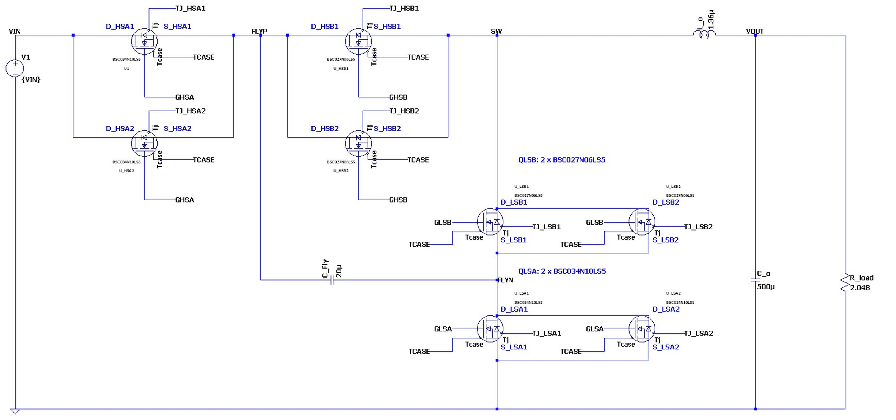
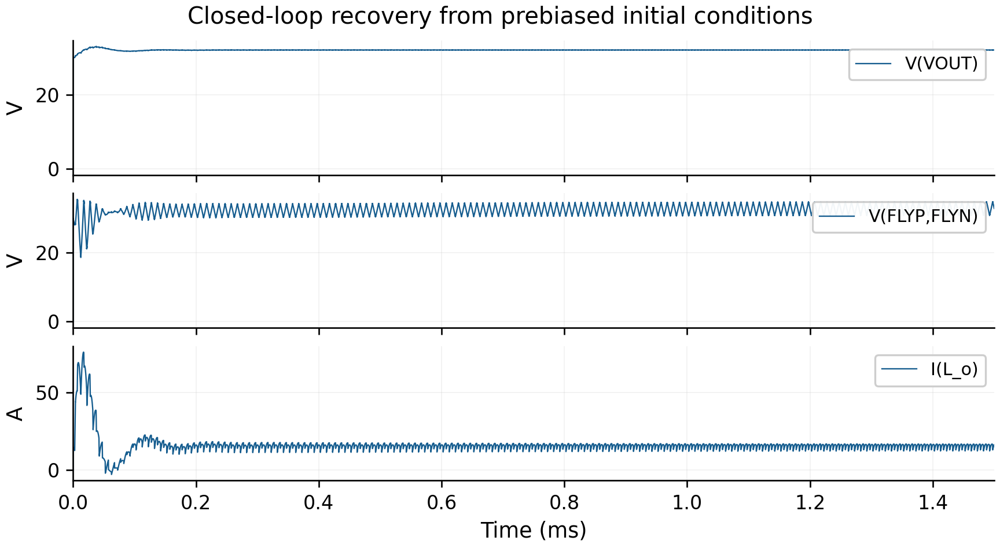
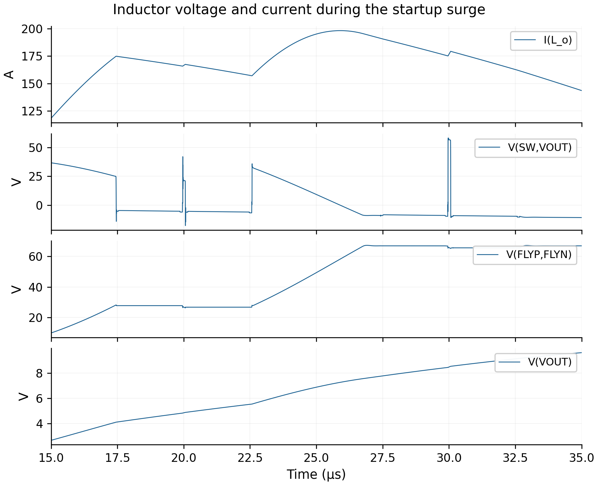

# Three-level buck converter: control and startup analysis

**Abdulrahman Ahmed Mohammed** · LTspice · power electronics · feedback control · numerical waveform analysis

A simulation study of a 66 V to 32 V, nominal 500 W three-level buck converter with separate voltage-mode loops for output regulation and flying-capacitor balancing. I reconstructed the published control approach in LTspice, evaluated regulation and load response, and investigated why startup current continued to rise after the output controller reached its minimum duty.

The strongest result is the startup explanation: a positive inductor-voltage integral predicts a **25.5383 A** current increase, agreeing with the **25.5384 A** measured increase. The model also exposes excessive current and switch-voltage stress that prevent claiming successful cold startup.

[Read the research report](report/P54_Research_Report.pdf) · [Circuit guide](docs/circuit-guide.md) · [Engineering analysis](docs/engineering-analysis.md)



## What I implemented

- Four switching banks with two parallel manufacturer-model MOSFETs per bank, a 20 µF flying capacitor, 1.36 µH output inductor and 500 µF output capacitor.
- Source-referenced behavioral gate drives and complementary 100 kHz triangular carriers.
- Separate error calculations, RC-state compensators and bounded duty commands for the flying-capacitor and output-voltage loops.
- Simulations of fixed PWM, prebiased feedback recovery, three input voltages, load changes, zero-energy startup and an output-reference ramp.
- Time-weighted regulation measurements, differential device-stress measurements and an inductor volt-second calculation to explain the startup transient.

The topology and independent-loop concept come from Jeong et al.; this project is a reconstruction and evaluation of that method. The behavioral controllers use the coefficients documented in the report. It is a simulation project; no hardware prototype or measured efficiency is claimed.

## Results

| Test | Observed result | Engineering implication |
|---|---|---|
| Prebiased feedback recovery, 66 V input | Mean output 32.00053 V; 54.823 mV peak-to-peak ripple over 1.45–1.50 ms | Close output regulation under the specified initial energy |
| Fixed PWM versus feedback | Fixed-PWM mean 32.18633 V; feedback mean 32.00053 V | Feedback corrects the modeled operating-point error |
| Input-voltage cases | Approximately 32 V output at 48, 66 and 70 V input | Regulation across both conversion regions |
| Load changes at 66 V input | Minimum 31.82610 V after load increase; maximum 32.18495 V after release | Output-capacitor current and feedback explain the response |
| Zero-energy cold start | 580.63 A peak; record ends at 58.273 µs | Cold startup is unresolved and current is excessive |
| Output-reference ramp | 198.21 A peak and 67.23 V flying-capacitor peak | Reference ramping alone is insufficient in this configuration |
| Reference-ramp switch stress | 67.704 V and 67.109 V on nominal 60 V banks | Device ratings are exceeded |

The cold-start and reference-ramp trials have different observation durations and startup conditions; the peak-current comparison is not a completed, single-variable demonstration of improved startup.



## Why the startup current kept increasing

For the output inductor,

```text
V_L = V_SW - V_OUT
di_L/dt = V_L / L
Δi_L = (1/L) ∫ V_L dt
```

At 18.1013 µs, the output command reaches its 0.02 lower limit. The flying-capacitor command remains near 0.495, so energy-transfer switching states continue. Between that instant and the current peak at 25.9107 µs, mean inductor voltage is +4.4475 V. Its integral explains the continued current increase quantitatively.



## Skills demonstrated

| Skill | Where to inspect the work |
|---|---|
| Power-stage modeling and model integration | Eight-device schematics and local manufacturer models in `circuits/` |
| Feedback implementation | Error sources, RC-state compensators, clamping and carrier expressions in the feedback schematics |
| Switching-state reasoning | Mode descriptions and differential gate/node analysis in the report |
| Dynamic analysis | Capacitor-current explanation of load changes; volt-second explanation of startup current |
| Numerical analysis | Windowed averages, ripple/extrema and model-derived capacitor charge, qualified in the report |
| Engineering judgment | Explicit separation of prebiased regulation, incomplete startup and voltage-rating exceedances |
| Technical communication | Shared LaTeX report, descriptive circuit names and readable simulation plots |

## Open the design

1. Install LTspice from Analog Devices.
2. Download or clone this repository.
3. Keep the `.asc`, `.asy` and `.lib` files together in `circuits/`.
4. Open a schematic described in the [circuit guide](docs/circuit-guide.md). All required custom symbol and library references are relative to that folder.
5. Read the initial conditions and transient command before simulating. The startup cases demonstrate unsuccessful operation and may be slow or numerically difficult.

The report and PNG figures contain the recorded results. Large binary RAW files are kept out of Git history; the complete professor package includes the original saved RAW data and plot settings. Files under `Plot_Settings/` require the corresponding RAW file or a new run with the same saved signals.

## Repository contents

```text
circuits/   Descriptive LTspice schematics, local symbols/libraries and plot settings
figures/    Actual schematic detail and plots made from original RAW samples
report/     Compiled research report
analysis/   Measurement definitions and worked startup calculation
docs/       Circuit guide, engineering explanation and model/source attribution
```

Plots in this README use the original LTspice numerical samples. No smoothing, filtering, waveform-value modification or spike removal was applied. Flying-capacitor current in the report is explicitly model-derived because its branch current was not saved.

## Reference and attribution

J.-B. Jeong, C.-G. Kim, J.-I. Kang and S.-K. Han, “Two Independent Single-Loop Voltage Mode Control Method for 3-Level Buck Converter,” *IEEE Access*, vol. 12, pp. 151382–151394, 2024. [DOI: 10.1109/ACCESS.2024.3476409](https://doi.org/10.1109/ACCESS.2024.3476409).

The report attributes reproduced artwork from that paper. Infineon models retain their original notices; see [third-party notices](THIRD_PARTY_NOTICES.md). This repository does not relicense third-party materials.
