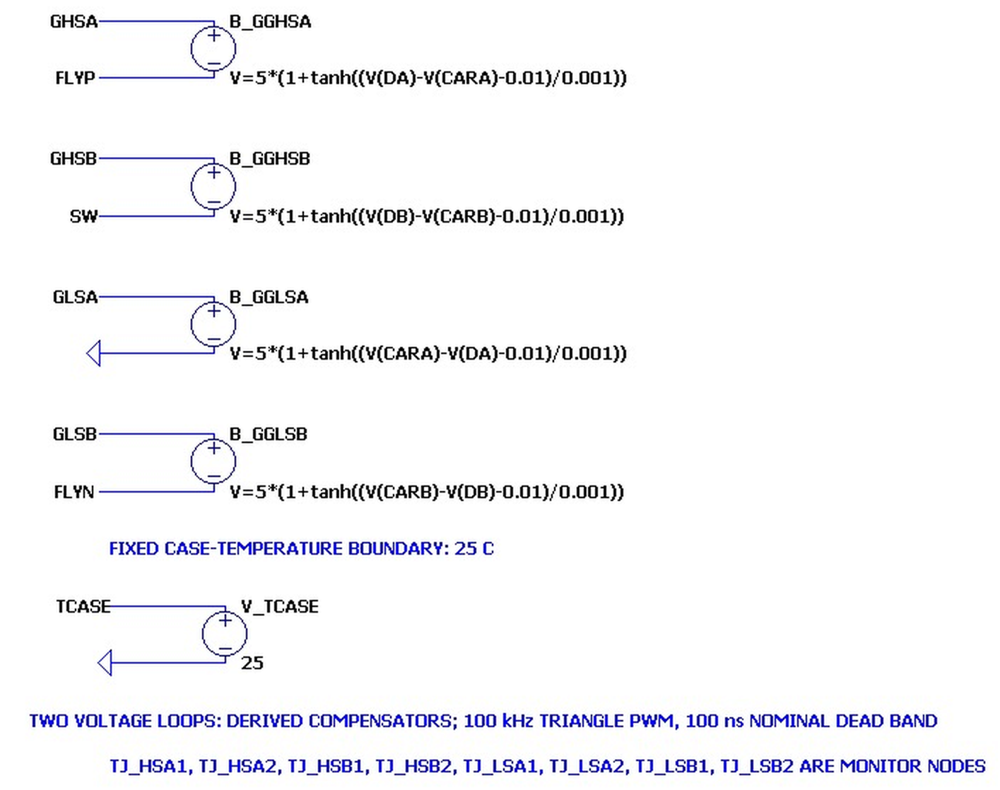
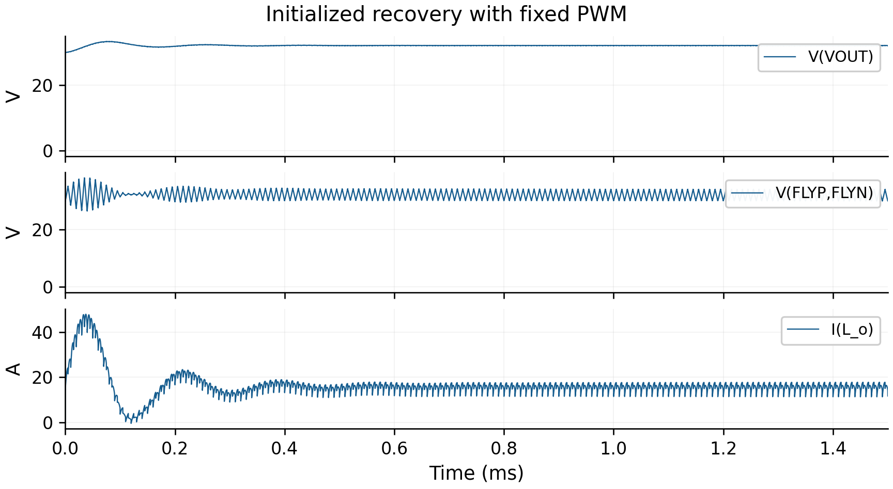
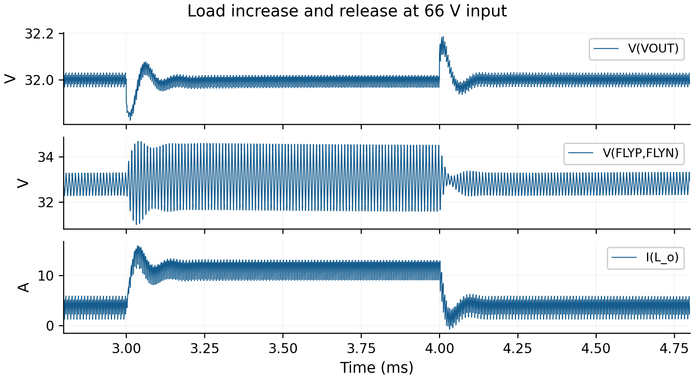
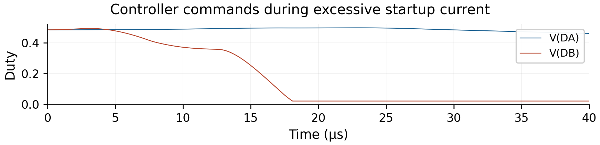

# Three-level buck converter: dual-loop control and startup investigation

Abdulrahman Ahmed Mohammed

LTspice reconstruction and numerical analysis of a nominal 66 V to 32 V, 500 W converter. I implemented a manufacturer-model power stage, reconstructed two voltage-mode control loops, compared operating conditions, and traced excessive startup current to the switching states that remain active after one duty command reaches its lower limit.

Prebiased feedback recovery reaches a late output mean of 32.00053 V. Zero-energy startup remains unsuccessful. The startup investigation links the observed +25.5384 A current rise to a +25.5383 A prediction from the inductor-voltage integral, while identifying voltage-rating exceedances in both 60 V banks.

[Full research report](report/P54_Research_Report.pdf) · [All 13 experiments](docs/circuit-guide.md) · [Every file and plot](docs/file-guide.md) · [Measurement method](analysis/measurement-method.md)


## Navigate the project

| Your goal | Start here | Continue with |
|---|---|---|
| Assess the engineering work | [What I built](#what-i-built-and-investigated) and [results](#results-and-what-they-establish) | [Complete report](report/P54_Research_Report.pdf) |
| Understand a schematic before running it | [Experiment guide](docs/circuit-guide.md) | [circuits/](circuits/) and [file reference](docs/file-guide.md) |
| Follow the startup explanation | [Current-rise calculation](#why-current-keeps-rising-at-minimum-output-duty) | [Engineering analysis](docs/engineering-analysis.md) and report diagnostics |
| Reproduce a measurement | [Measurement definitions](analysis/measurement-method.md) | Corresponding schematic and compatible RAW dataset |
| Review ownership and sources | [Contribution scope](#contribution-scope-and-reference) | [Third-party notices](THIRD_PARTY_NOTICES.md) |

## What I built and investigated

The work follows the converter from electrical implementation to operating-point evaluation and startup diagnosis:

1. Reconstructed the three-level buck power stage with four switching banks, two parallel MOSFET models per bank, a flying capacitor and an LC output filter. Integrated local manufacturer libraries and five-terminal device symbols.
2. Implemented source-referenced gate commands for floating switches. Used fixed PULSE drives in the open-loop cases and complementary triangular-carrier behavioral PWM in feedback cases.
3. Reconstructed separate error paths and RC-state compensators for flying-capacitor balancing and output regulation, including duty limits and explicit controller initial states.
4. Investigated fixed-PWM startup and output-capacitor ESR, recording large positive and reverse-current excursions and the associated convergence qualifications.
5. Evaluated feedback recovery with specified stored energy and compared it with a fixed-PWM run having matching storage initial conditions.
6. Ran separate initialized regulation cases at 48, 66 and 70 V input, spanning conversion ratios above and below one half.
7. Evaluated 25% to 75% load changes and releases at those three input voltages, relating the response to output-capacitor charge balance and ESR.
8. Examined zero-energy cold startup and a separate 1 ms output-reference ramp. Preserved the unsuccessful results and the actual recorded endpoints.
9. Diagnosed the reference-ramp current rise using source-referenced gate states, both duty commands, differential inductor voltage, volt-second integration and device-stress extrema.
10. Documented time-weighted measurements, distinguished saved branch quantities from model-derived estimates, and assembled the designs, plot settings and academic report for review.

## Design and controller implementation

| Quantity | Implementation |
|---|---|
| Nominal input / target output | 66 V / 32 V |
| Nominal output power / current | 500 W / 15.625 A at 2.048 Ω |
| Switching frequency | 100 kHz per switching group |
| Flying capacitor / output capacitor / inductor | 20 µF / 500 µF / 1.36 µH |
| Flying / output capacitor ESR | 3 mΩ / 13 mΩ, with a separate zero-output-ESR comparison |
| A banks | Two parallel 100 V BSC034N10LS5 models per bank |
| B banks | Two parallel 60 V BSC027N06LS5 models per bank |
| Device temperature boundary | Fixed 25 °C case temperature |

The flying capacitor produces the intermediate levels `VIN − VFly` and `VFly`. Balanced operation makes both approximately `VIN/2`. Startup imbalance changes the inductor voltage and switch stress; each parallel device still sees the complete bank voltage.

```text
Loop A: eA = V(VIN)/2 − V(FLYP,FLYN) → CTRL_A → CA
Loop B: eB = Vref − V(VOUT)          → CTRL_B → CB
DA = limit(32/VIN_parameter + CA, 0.02, 0.98)
DB = limit(32/VIN_parameter + CB, 0.02, 0.98)
```

The controller library uses explicit RC states. A unit capacitor driven by `k × error` and shunted by 100 Ω gives `k/(s + 0.01)`. Buffered low-pass states and weighted lead combinations implement the documented compensator transfer functions. Loop A has gain coefficient 10.4593927209 and a 53.05165 µs filter constant. Loop B uses 1661.90546898 and filter constants of 3.978874 µs and 1.989437 µs. The full coefficients and derivation are in the report and [controller library](circuits/Control_Compensators.lib).

Internal state capacitors start at zero. The duty clamps do not include explicit integrator reset or back-calculation anti-windup. Both commands affect the same energy-transfer network, so separate error signals do not guarantee independent startup behavior.



The behavioral PWM uses complementary triangular carriers, a `tanh` scale of 0.001 and a 0.01 command gap. Gate commands are measured relative to each device source. These abstractions support the simulated switching study; practical driver timing and protection still require evaluation.

## Results and what they establish

### Fixed-PWM startup and ESR

| Output-capacitor ESR | Maximum current | Minimum current | Maximum output |
|---|---:|---:|---:|
| 13 mΩ | 391.734 A | −133.529 A | 43.662 V |
| Zero | 432.963 A | −218.867 A | 46.679 V |

These measurements cover 0–450 µs. Removing ESR increases the positive current peak by 10.5% and reverse-current magnitude by 63.9%. Finite ESR provides damping in this comparison, but both cases retain excessive excursions and tolerance-relaxation warnings. The baseline open-loop flying-capacitor peak is 67.547 V; output still spans 31.575–32.426 V over 380–440 µs.

### Feedback recovery versus fixed PWM

Both runs use 66 V input, a 2.048 Ω load, capacitor initial voltages of 30 V, inductor initial current of 14.6484375 A, `uic`, and 1.5 ms duration. The late window is 1.45–1.50 ms.

| Metric | Fixed PWM | Feedback |
|---|---:|---:|
| Late output mean | 32.18633 V | 32.00053 V |
| Mean error from 32 V | +0.18633 V | +0.00053 V |
| Late output ripple | 82.82 mV pp | 54.82 mV pp |
| Full-record output peak | 33.39848 V | 32.92607 V |
| Late flying-terminal mean | 31.99919 V | 32.84464 V |
| Late current mean | 15.71619 A | 15.62448 A |
| Late current ripple | 6.4483 A pp | 4.4012 A pp |
| Full-record current peak | 47.9637 A | 75.8761 A |

Feedback improves late output regulation while producing a larger early current peak in these saved implementations. Pulse generation also differs between the runs, so the comparison includes that implementation difference. These results describe recovery from stored energy. In the feedback run the flying-terminal mean remains 0.15536 V below its 33 V target, with 3.9122 V peak-to-peak ripple.


<details>
<summary>View the fixed-PWM recovery counterpart</summary>



</details>

### Regulation at three input voltages

These are separate initialized 3 ms runs, measured over 2.95–3.00 ms.

| Input | Output mean | Output ripple | Flying-terminal mean | Inductor ripple |
|---|---:|---:|---:|---:|
| 48 V | 32.00000 V | 0.263 V pp | 23.999 V | 20.4704 A pp |
| 66 V | 32.00007 V | 0.052 V pp | 32.979 V | 4.1245 A pp |
| 70 V | 32.00005 V | 0.139 V pp | 34.985 V | 10.6639 A pp |

The output means remain close to 32 V while the flying voltage follows half the input. Current ripple changes substantially: the 48 V conversion ratio is 0.6667, compared with 0.4848 and 0.4571 at 66 and 70 V. The 66 V balanced intermediate level is close to the output, helping explain its smaller inductor ripple. These runs establish initialized operating-point behavior, without testing an input-voltage step.

### Load increase and release

Each 5 ms test changes the load from 8.192 Ω to 2.7306667 Ω at 3 ms and back at 4 ms. The nominal demands are 3.90625 A and 11.71875 A at 32 V.

| Input | Output minimum, 3–4 ms | Output maximum, 4–4.8 ms | Largest deviation from 32 V |
|---|---:|---:|---:|
| 48 V | 31.67668 V | 32.31843 V | ≈1.01% |
| 66 V | 31.82610 V | 32.18495 V | ≈0.58% |
| 70 V | 31.78458 V | 32.23187 V | ≈0.72% |

Switching ripple is included in these extrema. The approximately 7.8125 A load-current increase initially comes from the 500 µF output capacitor, giving an ideal voltage slope of −0.015625 V/µs. The 13 mΩ ESR contributes a voltage change of order 0.102 V. Load release reverses the capacitor-current imbalance. The switching waveform determines the actual extrema.



### Startup trials and device stress

| Trial | Recorded outcome | Scope |
|---|---|---|
| Zero-energy cold start | 580.63 A peak at about 47.729 µs | Ends at 58.273 µs of 400 µs requested |
| 1 ms output-reference ramp | 198.21 A maximum; −76.43 A minimum; 67.23 V flying-terminal peak | Only the first 100 µs is recorded |
| Reference-ramp output | 10.69 V peak; 7.71 V at record end | Reference is only 3.2 V at 100 µs |

The cases have different startup conditions and observation durations. Their peak-current difference does not establish a completed, controlled improvement in startup. The cold-start run is incomplete, and the ramped-reference case has excessive current, capacitor overvoltage and poor tracking. Gmin stepping was required in the reference-ramp run after direct Newton iteration failed.

| Bank | Nominal rating | Minimum VDS | Maximum VDS, reference-ramp record |
|---|---:|---:|---:|
| QHSA | 100 V | −5.275 V | 43.064 V |
| QHSB | 60 V | −20.251 V | 67.704 V |
| QLSB | 60 V | −12.491 V | 67.109 V |
| QLSA | 100 V | −9.671 V | 43.582 V |

Both 60 V banks exceed their blocking ratings. The fixed case-temperature model and behavioral drivers do not establish hardware safe operation.

## Why current keeps rising at minimum output duty

At 18.1013 µs, DB reaches 0.02 while inductor current is 172.674 A. Current rises to 198.212 A at 25.9107 µs. DA changes only from 0.49703 to 0.49491 across that interval, so substantial switching continues.

```text
V_L = V(SW,VOUT)
di_L/dt = V_L / L
Δi_L = (1/L) × integral(V_L dt)

L                           = 1.36 µH
Mean V_L                    = +4.4475 V
Interval                    ≈ 7.8094 µs
Predicted full-sample Δi_L   = +25.5383 A
Measured Δi_L               = +25.5384 A
```



During this interval, commanded Mode 1 occupies about 42.9%, Mode 2 52.0%, Mode 3 1.3%, and unclassified/dead-time commands 3.8%; Mode 4 is absent. Source-referenced gate voltages above 5 V are classified as ON using each interval's left sample. This is a command-state classification; transition diode conduction can differ.

The positive net inductor voltage explains the continued rise quantitatively. The DB floor leaves energy-transfer states active because the flying-capacitor command stays near 0.495. Coordinated startup energy limitation and balancing are therefore subjects for further investigation.


Direct flying-capacitor branch current was not saved. An ESR-aware estimate gives about 1.151 mC accumulated between 15 µs and the 67.2256 V terminal peak at 26.9002 µs. The report labels this as model-derived and states its RC assumptions. It is separate from the directly saved inductor-current evidence.

## Experiments and file navigation

There are 13 schematics and 21 plot settings. Each experiment has a same-topic default plot setting; eight additional settings expose switching states, stress and startup detail.

| Question | Schematics |
|---|---|
| What happens under fixed PWM? | [Baseline startup](circuits/Open_Loop_Startup_and_Switch_Stress.asc) |
| How does output ESR affect startup? | [13 mΩ](circuits/Startup_with_Output_ESR_13_mOhm.asc) · [Zero ESR](circuits/Startup_with_Zero_Output_ESR.asc) |
| What does feedback change in prebiased recovery? | [Feedback](circuits/Closed_Loop_Prebiased_Recovery.asc) · [Fixed PWM](circuits/Fixed_PWM_Prebiased_Recovery.asc) |
| How does initialized regulation depend on input? | [48 V](circuits/Voltage_Regulation_48V_Input.asc) · [66 V](circuits/Voltage_Regulation_66V_Input.asc) · [70 V](circuits/Voltage_Regulation_70V_Input.asc) |
| How does the converter respond to load changes? | [48 V](circuits/Load_Change_Response_48V_Input.asc) · [66 V](circuits/Load_Change_Response_66V_Input.asc) · [70 V](circuits/Load_Change_Response_70V_Input.asc) |
| Does zero-energy startup succeed? | [Cold start](circuits/Zero_Energy_Cold_Start.asc) |
| Why does current rise during a reference ramp? | [Reference-ramp startup](circuits/Output_Reference_Ramp_Startup.asc) |

The [experiment guide](docs/circuit-guide.md) explains the purpose, initialization, result and limitation of every schematic. The [file reference](docs/file-guide.md) lists every plot's actual trace expressions, its matching dataset and all six symbol/library dependencies.

```text
circuits/                 13 editable ASC schematics and 13 default PLT settings
  Plot_Settings/          8 additional waveform views
  *.asy, *.lib            3 custom symbols and 3 required libraries
figures/                  7 schematic details and RAW-based result figures
report/                   Complete compiled academic report
analysis/                 Measurement definitions and worked startup calculation
docs/                     Detailed experiment, file and engineering guides
THIRD_PARTY_NOTICES.md     Model and source-artwork attribution
```

## Open and reproduce the work

1. Download or clone the repository and open a schematic in LTspice.
2. Keep the custom `.asy` and `.lib` files beside the schematics in `circuits/`; retain the `Plot_Settings/` subfolder.
3. Read the experiment's initial conditions, `.tran` command and observation limits in the guide. `uic` prebiased tests and zero-energy `startup` tests answer different questions.
4. Run the schematic to generate new numerical data, or open the corresponding saved RAW from the separate complete professor package. Large binary RAW files and original logs are excluded from this Git repository.
5. Load the same-topic `.plt`. Additional diagnostic settings live in `circuits/Plot_Settings/`; use the dataset mapping in the file reference.
6. Apply the exact measurement window. Compute time-weighted means by trapezoidal integration with interpolated endpoints; use extrema for peak-to-peak ripple. Inspect logs alongside waveforms when evaluating convergence.

The report and figures show the recorded results. No smoothing, filtering, sample modification or spike removal was applied to RAW-based figures. New runs may depend on solver/platform behavior, especially in the unsuccessful startup cases. The repository does not include a full automated waveform-analysis pipeline; measurement definitions and worked calculations are documented in [analysis/measurement-method.md](analysis/measurement-method.md).

## Engineering skills and evidence

| Capability | Concrete evidence |
|---|---|
| Power-electronics modeling | Eight MOSFET models, bank connectivity, flying capacitor and LC filter in the schematics |
| Device-model integration | Local manufacturer subcircuits, five-terminal symbol mapping and fixed temperature boundary |
| Feedback realization | Two error paths, explicit RC-state compensators, bounded commands and carrier-based PWM |
| Experimental comparison | ESR pair, prebiased fixed/feedback pair, three input cases and three load-response cases |
| Transient reasoning | Output-capacitor charge balance at load edges; source-referenced state analysis during startup |
| Numerical analysis | Time-weighted windows, differential voltage stress and agreement between current rise and voltage integral |
| Technical judgment | Retained solver warnings, incomplete-record limits, adverse startup evidence and rating exceedances |
| Research communication | Referenced academic report, detailed circuit guide and trace-to-dataset file map |

## Limits and next engineering questions

Prebiased regulation is demonstrated under the stated simulation conditions. Successful cold startup, hardware operation, practical gate-drive behavior, thermal design and efficiency remain unverified. No hardware prototype or measured efficiency is claimed. Gate-state classification does not resolve every conduction path, and flying-capacitor charge is estimated from a terminal model.

Further work should evaluate coordination of the two duty commands during startup, current/energy limitation and flying-capacitor precharge or balancing strategies. Anti-windup behavior, semiconductor voltage margin, convergence sensitivity and practical driver timing also require evaluation. These are proposed investigations; they have not been implemented or validated here.

## Contribution scope and reference

The topology and independent-loop control concept come from the source paper. My work is the LTspice reconstruction and evaluation described above: integrating the power-stage models, implementing the reconstructed controller, comparing operating cases, analyzing the unsuccessful startup and documenting the evidence. The study does not claim invention of the topology or a validated hardware implementation.

J.-B. Jeong, C.-G. Kim, J.-I. Kang and S.-K. Han, “Two Independent Single-Loop Voltage Mode Control Method for 3-Level Buck Converter,” *IEEE Access*, vol. 12, pp. 151382–151394, 2024. DOI: `10.1109/ACCESS.2024.3476409`.

The report identifies source-paper artwork and its attribution. Infineon models retain their original notices. See [third-party notices](THIRD_PARTY_NOTICES.md) for ownership and reuse scope; this repository does not apply a blanket license to third-party material.
